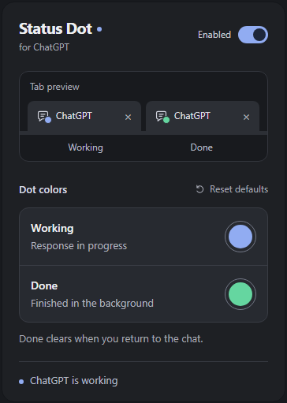

# ChatGPT Status Dot

See when ChatGPT finishes without switching back to the chat.

**[Download the current source (1.2.2)](https://github.com/Hxtomi/ChatGPT-Status-Dot/archive/refs/heads/main.zip)**

The shared source works in Microsoft Edge and other Chromium browsers. Version 1.2.2 has been submitted to Microsoft Edge Add-ons and is **in review** as of 29 October 2026. The store listing will become available after approval.

- **Blue:** ChatGPT is working.
- **Green:** a response finished while you were away.
- **No dot:** nothing is running or waiting to be read.

The dot appears on the tab icon and clears when you return to the chat. If you're already watching the response, it clears as soon as the answer finishes.

## Install

1. Download the source ZIP above and extract the repository into a permanent folder.
2. In Microsoft Edge, open `edge://extensions` and turn on **Developer mode**.
3. Click **Load unpacked** and select the `extension` folder inside the extracted repository.

If you cloned the repository with Git, select its `extension` folder. Older packaged builds remain available in [GitHub Releases](https://github.com/Hxtomi/ChatGPT-Status-Dot/releases).

For another Chromium browser, use its extensions page (for example `chrome://extensions`).

## Choose your colors

Open **ChatGPT Status Dot** from Microsoft Edge's extensions menu to change either color, switch the indicator off, or reset the defaults. The current-tab status updates while the popup stays open.

The tab preview updates as you pick a color.

Keep the chat tab open while you wait. Reloading it clears the unread indicator.

ChatGPT must be accessible in your browser; sign in if ChatGPT requires it. Detection depends on the site's generation controls. English and Russian Stop labels are supported. A website change can require an extension update. The indicator does not keep a sleeping or closed tab running.

## Privacy

Your settings stay in your browser. The extension doesn't collect your conversations or use analytics. [Privacy details](PRIVACY.md).

[Report a bug](https://github.com/Hxtomi/ChatGPT-Status-Dot/issues) · [Developer guide](docs/development.md) · [Edge submission kit](docs/edge/README.md) · [Apache-2.0](LICENSE)

Not affiliated with OpenAI.
